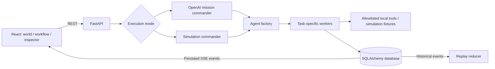

# Architecture

The server is the source of truth. The UI derives agents from the same immutable
event list for both views, and derives replay state from an event prefix. Events
are committed alongside task and lifecycle changes before SSE reads them.

Agent instances have separate IDs, configuration, task ownership and state. Workers
receive predecessor outputs and emit structured handoffs. A deterministic commander
selects a scenario-specific plan. Local functions really calculate and verify the
synthetic result; the planning decisions are scripted. The commander combines the
last verified output. No user code or arbitrary network request runs.

One Python process owns execution. Database-backed polling supports reconnects, but
multiple API workers are unsupported because task ownership and admission limits
are currently process-local. Ready tasks execute sequentially; parallel scheduling,
distributed leases and transactional outbox are future work.
Interrupted missions become failed on startup. Pause/cancel take effect at the next
checkpoint, after any current local operation. Database sessions contain no async
waits; SQLite serializes writes in the single-process loop.

`tools.py` implements observable fixture operations as a generator. The worker
persists input, tool start, each computed operation/value, and tool completion;
checkpoints between stages keep observation and cancellation possible. `workFor()`
derives the current attempt's trace from an event prefix, preventing replay from
revealing future values or retaining an earlier failed attempt's result. The
Inside the work view auto-follows the latest worker or lets the learner pin one.

## Live execution

Live mode uses the Responses adapter in `provider.py` and a validated mission
plan in `live_schemas.py`. The commander chooses 1–6 workers and an acyclic task
graph. `live.py` creates the team, delivers accepted predecessor outputs, and runs
observe → plan → act → test cycles. Tools in `live_tools.py` are scoped text
creation, arithmetic and context inspection. There is no browser, shell or
arbitrary network access. All public loop artifacts become durable events.

Strict structured outputs, local tool validation, rubric review, iteration/call/
token/spending/time guards bound execution. Private reasoning is neither requested
nor persisted. A model review is not an independent factual check. Cancellation
can interrupt a provider call; uncertain usage reserves the request estimate.
See LIVE_ORCHESTRATION.md for the complete live path and limitations.
