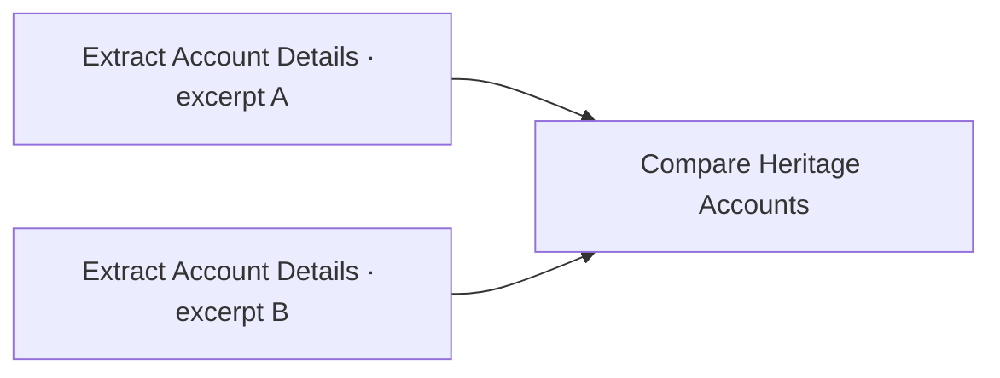

# Skills-first missions

See [SKILLS_VERIFICATION.md](SKILLS_VERIFICATION.md) for the completed checks,
their limits, and the existing-data migration comparison.

New Live AI missions use the existing Master Agent as the primary executor.
Skills describe reusable procedures; they do not create permanent agents.
The original agent-team engine remains available under **Execution settings**,
and existing missions retain their original agents, configurations and events.

## Skill catalog and revision lifecycle

Open **Skills** to create a draft, import `SKILL.md`, inspect/edit a revision,
export a revision, activate it, or deactivate the skill. Every skill belongs to
the current user workspace and has a stable UUID. Revisions contain a name,
applicability description, instructions, named input contracts and output
contracts. Input names use letters, numbers and underscores.

Saving edits creates a new immutable draft revision. If v1 is active while v2
is a draft, Auto still considers v1's name, description and instructions.
Activation explicitly publishes the latest saved draft. Deactivation removes a
skill from future selection; planned and historical runs retain their snapshots.
The page distinguishes the active revision from the latest draft.

`SKILL.md` imports use safe YAML with required `name` and `description` front
matter and a Markdown instruction body. Optional `inputs` and `outputs` preserve
structured contracts. Exports also identify the stable skill ID and revision in
`metadata`. Import always creates a new draft with its own ID; it never silently
updates or activates an existing skill. YAML aliases and excessive nesting are
rejected. See the two [example skills](examples/skills).

## Normal mission flow

1. Choose **Master Agent & skills**, then **Auto**, **Master only**, or an active
   skill in the mission form. Supply this run's values in **Current mission
   inputs**. Attachments remain available through the existing source controls.
2. In Live AI, the Master receives active skill names/descriptions first. After
   selecting applicable IDs, only those skills' full revisions are loaded for
   planning. No match produces a direct Master workflow. Manual selection pins
   the chosen active revision. Explicit per-step skill choices are also accepted.
3. Review the interpreted request, steps, dependencies, skill versions, scoped
   delegation reasons, estimated usage and concurrency limit. Planning itself can
   make paid requests; execution waits for **Approve steps & run**.
4. The scheduler starts ready steps with up to the selected limit (1–4). A
   dependent step starts only when every declared prerequisite has an accepted
   result. Its named inputs bind current mission values or prerequisite results.
5. Missing required values are reported before the affected step executes. Add
   missing values without replacing existing ones. Nested missing fields can be
   filled when this leaves already accepted steps' bound inputs unchanged.
6. Failed steps retain failure details and review events. Correct a failed step's
   instructions if necessary, then retry it or resume the stopped workflow.
   Completed outputs and pinned skill revisions are reused. Existing values and
   accepted step instructions cannot be changed behind cached results.
7. The Master reviews Live AI step outputs and the assembled final answer before
   recording final approval. Supplemental discovery, if requested, uses the
   existing related-resources mechanism and retains the approved answer if it fails.

The existing provider, tool allowlist, source handling, request accounting,
pause/cancel controls, answer exports and history endpoints are reused. Concurrent
requests reserve estimated tokens/cost before dispatch to avoid overcommitting a
bounded allowance. No paid automatic retry is introduced by the new scheduler.
Normal UI missions retain the app's existing open-ended cost policy; estimates
are not a provider billing guarantee. One Live AI mission still runs at a time.

## Delegation and history

The Master executes ordinary steps itself, including independent parallel work.
A separate agent is permitted only for `isolated_context`, `independent_review`
or `different_permissions`, with an explicit rationale and scoped input bindings.
Delegated Live AI steps use the existing `live_worker` observe/plan/act/test
executor and its allowed tools. They do not receive unrelated mission inputs or
uploaded documents. Agents cannot acquire tools beyond the existing allowlist.

Delegation creates run-scoped agent/task records, not permanent registrations.
Successful delegated agents are released; their configurations and reasons are
retained as audit history. Master steps create no agent/task records at all.
Old missions remain accessible through the existing history and inspector views.
The new step view records status, exact skill version, inputs, results, attempts,
dependency failures and correction events. Interrupted running steps are marked
failed at startup and require explicit retry; accepted results are retained.

## Capture a reusable workflow

After completion, use **Save as skill**, including on historical legacy runs.
The Master can also recommend reuse from a successful new workflow. The capture
operation builds a conservative procedural draft: operations, input names,
dependency rules and canonical correction categories are retained. Repeated
independent operations become a rule to process each current account separately.
Prompts, source documents, input/output values, credentials and raw correction
text are deliberately excluded. Review and edit the resulting instructions;
capture is not a claim that every possible procedure was inferred perfectly.

When the run used a single existing skill, the draft proposes a new revision of
that skill. Otherwise a catalog match must have a compatible name and input
contract. Composite workflows do not overwrite an unrelated extraction skill.
The previous active revision stays active until the new draft is explicitly
activated. Historical runs keep the exact revision that actually ran.

## Omani heritage demonstration

The two provided excerpts are **self-authored fictional classroom material**, not
historical sources. They share a location and tradition, and differ in account,
collection description and purpose. Their references are `CLASSROOM-OMAN-A` and
`CLASSROOM-OMAN-B`; neither is presented as a bibliographic citation.

In **Skills**, choose **Add heritage example drafts**, review each, and activate
both **Extract Account Details** and **Compare Heritage Accounts**. Choose **Try
heritage workflow**. The mission form loads both excerpts into current inputs,
selects Auto and a concurrency limit of two, and uses no-cost Simulation mode.
You can edit the excerpts before submitting. For general tasks, use Live AI;
Simulation is a deliberately scripted classroom executor and description matcher.



Approve the plan. Both extractions run concurrently using the same skill ID and
revision with different inputs. Comparison waits for both and produces separate
**Agreement** and **Differences** sections, retaining the supplied references.
Tick the one-time failure checkbox to hold the second extraction. The first
result remains accepted; retry completes with attempt counts **1, 2, 1**.

## Reproduce verification

From `backend`:

```powershell
python -m pip install -r requirements.txt
python -m pytest -q
python scripts/verify_skill_workflows.py
```

The script signs into a new disposable workspace and uses the same mission,
approval, skill import/activation, history and retry APIs as the browser. It
writes `tmp/skill-verification/report.json` and `heritage-comparison.md`. It tests
no-match → draft → activation, Auto with fresh inputs, parallel extraction plus
dependent comparison, failed-step retry, and original agent/history access.
It never reads production credentials or calls an external AI provider.

For the real built UI against that disposable database:

```powershell
# frontend
npm ci
npm run build
# backend
python scripts/preview_skill_workflows.py
```

Open `http://127.0.0.1:8028`. The fixture-only sign-in is documented in the preview
script; it has no relationship to the real administrator's credentials. Existing
verification missions can be opened from **Mission history**. External AI calls
are disabled in this preview.

## Migration and configuration

Back up an existing database, install requirements (adds PyYAML), then run from
`backend` before restarting the API:

```powershell
python -m alembic upgrade head
```

Migration `0007` adds versioned skill/workflow tables and a mission execution
strategy column. Existing rows default to `legacy`. It does not rebuild or
rewrite existing agents, tasks or events. Downgrade removes new skill/workflow
data, so keep a backup before rolling back. The normal VPS deployment script
already backs up the persistent database and runs migrations before startup.
No new provider key, account, user role or external service is required.

Key API additions are `/api/skills`, `/api/skills/import`, revision activation /
deactivation / export, `/api/missions/{id}/workflow`, workflow approval / retry /
missing inputs / step corrections, and `/api/missions/{id}/workflow/skill-draft`.
Use the ordinary authenticated session; all new records are workspace scoped.
